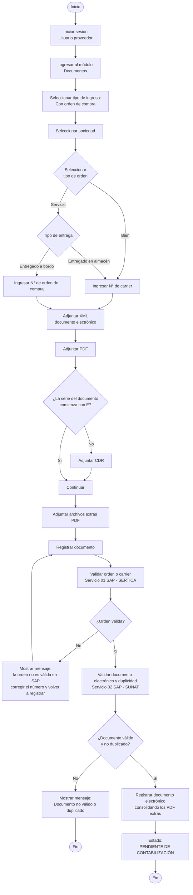

# Flujo 01 · Registro de documento con orden de compra

| Campo        | Valor                                                                                                                                                                                                                                             |
| ------------ | ------------------------------------------------------------------------------------------------------------------------------------------------------------------------------------------------------------------------------------------------- |
| Actor        | Usuario proveedor                                                                                                                                                                                                                                 |
| Pantalla     | Registrar documentos › Con orden de compra                                                                                                                                                                                                        |
| Estado final | Pendiente de contabilización                                                                                                                                                                                                                      |
| Servicios    | SAP 01 (validar orden · SERTICA), SAP 02 (validar documento y duplicidad · SUNAT)                                                                                                                                                                 |
| Versión      | 2026-11-19: tipo de entrega en órdenes de servicio y validación de la orden al registrar, según el diseño «Propuesta 4» ([spec 012](../specs/012-registro-propuesta-4/requisitos.md)). Versión anterior: 2026-10-17 (flujo entregado por negocio) |

## Reglas

- Solo el **usuario proveedor** registra con orden de compra.
- Tipo de orden **Bien** → se ingresa el N° de carrier. **Servicio** → se elige el tipo de entrega: **entregado a bordo** (N° de orden de compra) o **entregado en almacén** (N° de carrier).
- Los archivos se cargan desde el inicio; la orden se valida en SAP (servicio 01) al pulsar «Registrar documento». Si no es válida, no se registra, se conservan los archivos y se pide corregir el número.
- El **CDR** es obligatorio salvo que la serie del documento empiece con «E».
- Los archivos extras (PDF) se consolidan en un solo archivo.
- Al adjuntar el XML se muestra el **detalle del documento electrónico** leído del archivo.
- Válido y no duplicado (servicio 02 + SUNAT) → **Pendiente de contabilización** (no pasa por aprobación).
