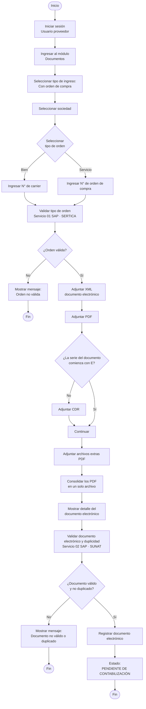

# Flujo 01 · Registro de documento con orden de compra

| Campo | Valor |
|---|---|
| Actor | Usuario proveedor |
| Pantalla | Registrar documentos › Con orden de compra |
| Estado final | Pendiente de contabilización |
| Servicios | SAP 01 (validar orden · SERTICA), SAP 02 (validar documento y duplicidad · SUNAT) |
| Versión | 2026-10-17 (flujo entregado por negocio) |

## Reglas

- Solo el **usuario proveedor** registra con orden de compra.
- Tipo de orden **Bien** → se ingresa el N° de carrier; **Servicio** → el N° de orden de compra.
- Los archivos se habilitan solo con la orden validada en SAP (servicio 01).
- El **CDR** es obligatorio salvo que la serie del documento empiece con «E».
- Los archivos extras (PDF) se consolidan en un solo archivo.
- Antes de validar en SAP se muestra el **detalle del documento electrónico** leído del XML.
- Válido y no duplicado (servicio 02 + SUNAT) → **Pendiente de contabilización** (no pasa por aprobación).
