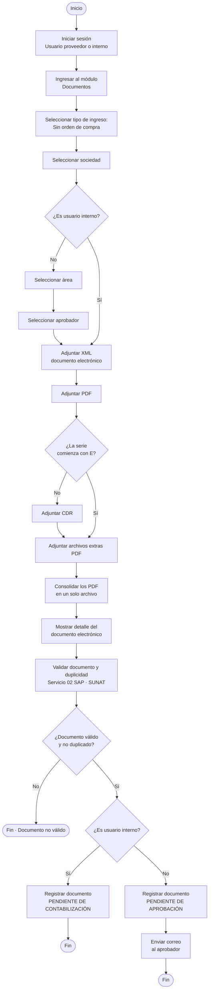

# Flujo 02 · Registro de documento sin orden de compra

| Campo | Valor |
|---|---|
| Actor | Usuario proveedor o usuario interno |
| Pantalla | Registrar documentos › Sin orden de compra |
| Estado final | Interno: Pendiente de contabilización · Proveedor: Pendiente de aprobación |
| Servicios | SAP 02 (validar documento y duplicidad · SUNAT) |
| Versión | 2026-10-17 (flujo entregado por negocio) |

## Reglas

- **Proveedor**: elige área y aprobador; el documento queda en **Pendiente de aprobación** y se envía un correo al aprobador.
- **Usuario interno**: no elige área ni aprobador; el documento queda directo en **Pendiente de contabilización**.
- El **CDR** es obligatorio salvo que la serie empiece con «E».
- Los archivos extras (PDF) se consolidan en un solo archivo.
- Antes de validar en SAP se muestra el **detalle del documento electrónico** leído del XML.
