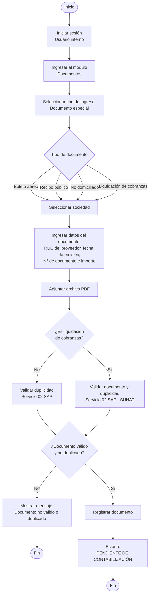

# Flujo 03 · Registro de documentos especiales

| Campo | Valor |
|---|---|
| Actor | Usuario interno |
| Pantalla | Registrar documentos › Documentos especiales |
| Estado final | Pendiente de contabilización |
| Servicios | SAP 02 (duplicidad); liquidación de cobranzas: SAP 02 + SUNAT |
| Versión | 2026-10-17 (flujo entregado por negocio) |

## Reglas

- Solo el **usuario interno** registra documentos especiales.
- Tipos: boleto aéreo, recibo público, no domiciliado y liquidación de cobranzas.
- Se ingresan manualmente RUC del proveedor, fecha de emisión, N° de documento e importe, y se adjunta un PDF.
- La **liquidación de cobranzas** se valida en SAP y SUNAT; los demás tipos solo por duplicidad en SAP.
- Válido → **Pendiente de contabilización** (no pasa por aprobación).
