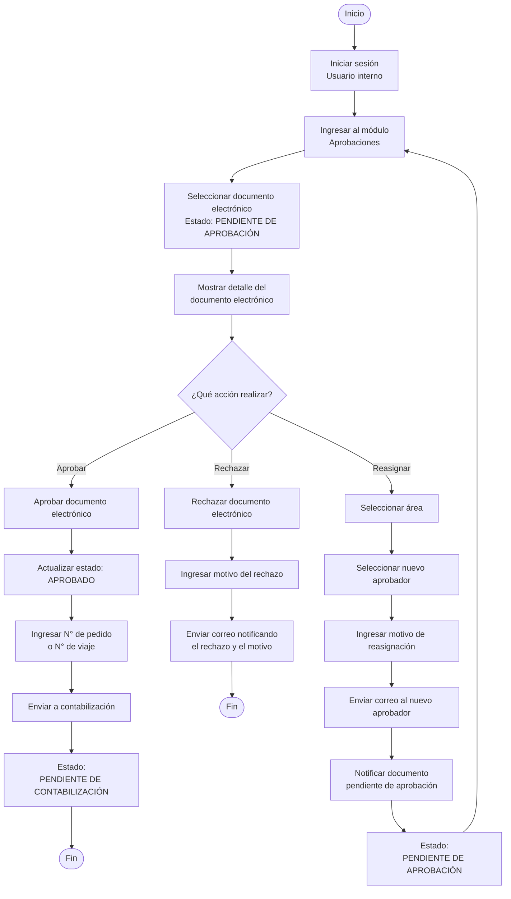

# Flujo 04 · Aprobaciones

| Campo | Valor |
|---|---|
| Actor | Usuario interno (aprobador de área) |
| Pantalla | Documentos (bandeja de aprobación) |
| Estado de entrada | Pendiente de aprobación |
| Versión | 2026-10-17 (flujo entregado por negocio) |

## Reglas

- **Aprobar**: exige el N° de pedido o de viaje; el documento pasa a **Pendiente de contabilización**.
- **Rechazar**: exige motivo; se envía un correo con el rechazo y el motivo.
- **Reasignar**: exige área, nuevo aprobador y motivo; se envía un correo al nuevo aprobador y el documento sigue en **Pendiente de aprobación**.
