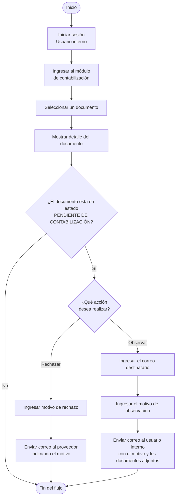

# Flujo 05 · Contabilización

| Campo | Valor |
|---|---|
| Actor | Usuario interno (Cuentas por pagar) |
| Pantalla | Contabilización |
| Estado de entrada | Pendiente de contabilización |
| Versión | 2026-10-17 (flujo entregado por negocio) |

## Reglas

- Solo se actúa sobre documentos en **Pendiente de contabilización**; los demás se consultan.
- **Rechazar**: exige motivo; se envía un correo al proveedor con el motivo.
- **Observar**: exige correo destinatario y motivo; se envía un correo a ese usuario interno con el motivo **y los documentos adjuntos** (XML, PDF, CDR y extras).
- El paso a **Contabilizado** (servicio 03 de SAP) no forma parte de este flujo.
